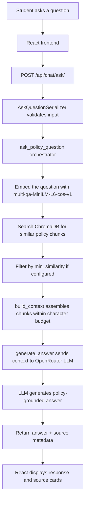
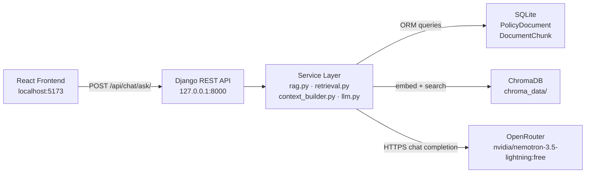

# College Policy AI Assistant

An AI-powered college policy assistant that helps students understand college policies through Retrieval-Augmented Generation (RAG).

Students type a question about the Northstar College Policy Handbook, the backend retrieves the most relevant policy sections, and an LLM generates a clear, grounded answer with source references and page numbers.

---

## Table of Contents

1. [Overview](#overview)
2. [Features](#features)
3. [Technology Stack](#technology-stack)
4. [How the Project Works](#how-the-project-works)
5. [System Architecture](#system-architecture)
6. [RAG Pipeline](#rag-pipeline)
7. [Project Structure](#project-structure)
8. [Prerequisites](#prerequisites)
9. [Installation and Setup](#installation-and-setup)
10. [Environment Configuration](#environment-configuration)
11. [Running the Application](#running-the-application)
12. [API Reference](#api-reference)
13. [Testing](#testing)
14. [Troubleshooting](#troubleshooting)
15. [Security](#security)
16. [Known Limitations](#known-limitations)
17. [Future Improvements](#future-improvements)
18. [Contributing](#contributing)

---

## Overview

Traditional AI chatbots answer questions from general training data that may not include a specific college's rules, deadlines, or procedures. This project solves that problem by using **Retrieval-Augmented Generation (RAG)**.

### What is RAG?

RAG works in two phases:

1. **Ingestion:** The college policy PDF is split into small chunks of text. Each chunk is converted into a numeric vector (called an *embedding*) that captures its meaning. These vectors are stored in a vector database (ChromaDB).

2. **Question answering:** When a student asks a question, that question is also converted into an embedding. ChromaDB finds the most semantically similar policy chunks. The matched chunks are included as context in a prompt sent to an LLM. The LLM then generates an answer that is grounded in those retrieved policy sections.

This means the AI's responses are based on the actual college handbook, not guessed from general knowledge. Source labels and page numbers are returned alongside every answer so students can verify what they read.

> **Note:** Answers are grounded in the retrieved context but are not a legal substitute for official college communications. Always confirm critical deadlines with the Academic Registrar.

---

## Features

### Policy Document Processing

- PDF text extraction page-by-page using **PyMuPDF** (`fitz`).
- Structure-aware recursive chunking that detects section headings and avoids splitting mid-sentence.
- Chunk overlap of 150 characters to preserve cross-boundary context.
- Chunk metadata retains the original page number and section title.
- Document chunk persistence in SQLite via Django ORM.
- ChromaDB synchronization after chunk creation.

### Semantic Retrieval

- All chunks are embedded using the `sentence-transformers/multi-qa-MiniLM-L6-cos-v1` model (384-dimensional vectors).
- Vectors are stored in a persistent **ChromaDB** collection using cosine similarity space.
- Semantic similarity search retrieves the most relevant policy chunks for a given question.
- Optional `document_id` filter restricts retrieval to a specific document.
- Optional `min_similarity` threshold filters out low-relevance results.
- Context is bounded by a configurable character budget (default 12,000 characters).
- Duplicate chunks are de-duplicated before context assembly.

### AI Answer Generation

- Questions and retrieved context are sent to an **OpenRouter**-hosted LLM.
- The configured model is `nvidia/nemotron-3.5-lightning:free` (overridable via environment variable).
- A dedicated system prompt instructs the model to answer only from retrieved context, never to invent policies, and to write in natural English.
- The response includes the generated answer and a list of source metadata objects (chunk ID, section title, page number, similarity score).
- When no relevant context is found, a clear fallback message is returned instead of calling the LLM.
- HTTP timeout, network errors, and malformed API responses are handled gracefully.

### Student-Facing Frontend

- Minimal, single-page React chat interface with an editorial warm ivory design.
- **Welcome screen** with quick-start suggested policy questions.
- **Chat thread** that shows user messages and AI responses in a readable conversation layout.
- **Markdown rendering** — bold text, lists, and paragraphs are formatted correctly.
- **Source reference cards** displayed below each AI response, showing section titles, page numbers, and similarity scores.
- **Loading indicator** while the backend processes the request.
- **Error banner** for network failures or service-unavailable conditions.
- **Clear Chat** button to reset the conversation back to the welcome screen.
- Responsive layout that works on desktop and mobile.

---

## Technology Stack

### Frontend

| Technology | Version | Role |
|---|---|---|
| React | 19.x | UI component library |
| Vite | 6.x | Development server and build tool |
| JavaScript (ES Modules) | — | Application language |
| CSS Custom Properties | — | Centralized design system (variables, layout, components) |
| lucide-react | 1.x | Icon components |

### Backend

| Technology | Version | Role |
|---|---|---|
| Python | 3.14.x | Backend language |
| Django | 6.1.x | Web framework and ORM |
| Django REST Framework | 3.18.x | API views and serializers |
| django-cors-headers | 4.9.x | CORS middleware for frontend-backend communication |
| python-decouple | 3.8 | Environment variable loading |

### Document Processing

| Technology | Version | Role |
|---|---|---|
| PyMuPDF (`fitz`) | 2.x | PDF text extraction page by page |

### Embeddings

| Technology | Version | Role |
|---|---|---|
| Sentence Transformers | 6.x | Converts text into semantic embedding vectors |
| Model: `multi-qa-MiniLM-L6-cos-v1` | — | 384-dimensional embedding model, optimized for semantic search |

> The embedding model converts text into numbers that represent meaning. Texts with similar meanings produce similar vectors, which is what allows ChromaDB to find relevant policy chunks for a given question.

### Vector Database

| Technology | Version | Role |
|---|---|---|
| ChromaDB | 1.5.x | Persistent vector store and cosine similarity search |

> ChromaDB stores the embedding vectors alongside metadata (page number, section title, document ID). During question answering, it finds chunks whose meaning is closest to the question's embedding.

### LLM Provider

| Technology | Role |
|---|---|
| OpenRouter | Routes API requests to hosted LLMs |
| `nvidia/nemotron-3.5-lightning:free` | Default LLM used for answer generation |

> The LLM is responsible only for generating a natural language answer from the retrieved policy text. It does not perform retrieval or access the internet.

### Database

| Technology | Role |
|---|---|
| SQLite | Relational database for local development (stores document and chunk records) |

### Development Tools

| Tool | Role |
|---|---|
| Git + GitHub | Version control and collaboration |
| Django test framework | Backend test runner |
| `unittest.mock` | Mocking external services in tests |

---

## How the Project Works



**Step-by-step explanation:**

1. The student types a question in the React chat interface.
2. The frontend sends a `POST` request to `http://127.0.0.1:8000/api/chat/ask/` with the question.
3. `AskQuestionSerializer` validates the question, `top_k`, `document_id`, and `min_similarity` fields.
4. `ask_policy_question` in `rag.py` orchestrates the entire pipeline.
5. The retrieval service converts the question into an embedding vector using the Sentence Transformers model.
6. ChromaDB performs a cosine similarity search and returns the most relevant policy chunks.
7. If `min_similarity` is set, chunks below the threshold are discarded.
8. `build_context` assembles the selected chunks into a structured context string, respecting the 12,000-character budget and de-duplicating by chunk ID.
9. `generate_answer` formats the question and context into a prompt and sends it to OpenRouter.
10. The LLM returns a natural-language answer grounded in the retrieved policy text.
11. The backend returns the answer, a list of source references (chunk ID, section title, page number, similarity), and retrieval statistics.
12. React renders the answer with formatted text and expandable source reference cards.

---

## System Architecture



---

## RAG Pipeline

### A. Document Ingestion (Backend — One-Time Setup)

The policy PDF is processed by the backend and indexed in ChromaDB before any student queries are served. This step is not triggered from the student frontend.

1. **PDF uploaded** — A `PolicyDocument` record is created via `POST /api/documents/`.
2. **PDF extraction** — `extract_pdf_pages()` in `pdf_loader.py` uses PyMuPDF to read text from each page, returning a list of `{page, text}` dictionaries.
3. **Structure-aware chunking** — `chunk_extracted_pages()` in `chunking.py` splits each page into sections using heading detection (uppercase lines, numbered sections, policy ID patterns like `ATT-01 | MINIMUM ATTENDANCE`). Each section is then recursively split into chunks of up to 1,000 characters with 150-character overlap. Section headings are prepended to each chunk so the embedding captures its context.
4. **Chunk persistence** — `DocumentChunk` records are bulk-created in SQLite. Each record stores `chunk_index`, `page_number`, `section_title`, and `content`.
5. **Embedding generation** — `sync_document_chunks()` in `vector_store.py` calls `embed_texts()`, which uses `SentenceTransformer("sentence-transformers/multi-qa-MiniLM-L6-cos-v1")` to convert each chunk into a 384-dimensional normalized vector.
6. **ChromaDB indexing** — The vectors, chunk text, and metadata (document ID, chunk index, page number, section title) are upserted into the `college_policy_chunks` collection.
7. **Status update** — The `PolicyDocument` status is set to `processed`.

> Embeddings are generated **once during ingestion**. They are not recomputed for stored chunks during question answering.

### B. Question-Answering Pipeline (Per Request)

1. The student submits a question from the React interface.
2. `AskQuestionSerializer` validates the question (max 2,000 characters), `top_k` (1–10, default 5), optional `document_id`, and optional `min_similarity` (0.0–1.0).
3. `retrieve_relevant_chunks()` embeds the question using the same `multi-qa-MiniLM-L6-cos-v1` model.
4. `search_similar_chunks()` queries ChromaDB with the question embedding and retrieves the top `n_results` chunks by cosine similarity. The similarity score is computed as `1.0 - distance`.
5. Chunks below `min_similarity` are discarded if the threshold is configured.
6. `build_context()` iterates through the retrieved chunks in retrieval order. It deduplicates by chunk ID, formats each chunk as a numbered source block (`[Source N]`) with its metadata header, and enforces a 12,000-character context budget.
7. `generate_answer()` constructs an OpenAI-compatible request with the system prompt and the formatted context + question as the user message. It sends the request to `https://openrouter.ai/api/v1/chat/completions` using `httpx`.
8. The LLM generates a natural-language answer following the system prompt rules: answer only from the context, never invent facts, write in clean professional English.
9. The backend returns `{ answer, sources, retrieved_chunk_count, included_chunk_count, excluded_chunk_count }`.
10. React renders the answer and displays the source reference cards.

---

## Project Structure

```text
rag_small_project/
│
├── backend/
│   ├── config/
│   │   ├── settings.py          # Django settings, OpenRouter config, CORS
│   │   ├── urls.py              # Root URL configuration
│   │   ├── asgi.py
│   │   └── wsgi.py
│   │
│   ├── knowledge_base/
│   │   ├── services/
│   │   │   ├── pdf_loader.py        # PDF text extraction (PyMuPDF)
│   │   │   ├── chunking.py          # Structure-aware recursive chunking
│   │   │   ├── embeddings.py        # Sentence Transformer embedding helpers
│   │   │   ├── vector_store.py      # ChromaDB client, upsert, search
│   │   │   ├── retrieval.py         # Similarity retrieval and filtering
│   │   │   ├── context_builder.py   # Context assembly within character budget
│   │   │   ├── prompts.py           # System prompt for the LLM
│   │   │   ├── llm.py               # OpenRouter API communication
│   │   │   └── rag.py               # RAG orchestration pipeline
│   │   │
│   │   ├── migrations/              # Django database migrations
│   │   ├── models.py                # PolicyDocument, DocumentChunk models
│   │   ├── serializers.py           # PolicyDocumentSerializer, AskQuestionSerializer
│   │   ├── views.py                 # API view classes
│   │   ├── urls.py                  # App URL patterns
│   │   └── tests.py                 # 58 unit and integration tests
│   │
│   ├── media/
│   │   └── policies/
│   │       └── college_policy.pdf   # Northstar College Policy Handbook (tracked in Git)
│   │
│   ├── .env.example                 # Environment variable template
│   ├── manage.py
│   └── requirements.txt
│
├── frontend/
│   ├── public/
│   │   └── favicon.svg
│   ├── src/
│   │   ├── components/
│   │   │   ├── Header.jsx           # Brand header with clear-chat action
│   │   │   ├── WelcomeScreen.jsx    # Hero, description, quick-start pills
│   │   │   ├── ChatMessage.jsx      # User and assistant message bubbles
│   │   │   ├── ChatInput.jsx        # Auto-resizing textarea with submit
│   │   │   ├── SourceReferences.jsx # Expandable policy source cards
│   │   │   └── LoadingIndicator.jsx # Typing indicator during LLM call
│   │   ├── services/
│   │   │   └── api.js               # Centralized DRF API client
│   │   ├── styles/
│   │   │   ├── variables.css        # CSS custom properties (design tokens)
│   │   │   ├── layout.css           # Page and container layout rules
│   │   │   ├── components.css       # Component-level styles
│   │   │   └── index.css            # Global resets and font imports
│   │   ├── App.jsx                  # Root application component
│   │   └── main.jsx                 # React entry point
│   ├── .env.example                 # Frontend environment variable template
│   ├── .gitignore
│   ├── index.html
│   ├── package.json
│   └── vite.config.js               # Vite config with /api proxy to Django
│
├── .gitignore                       # Root gitignore
└── README.md
```

**Key directories explained:**

| Path | Purpose |
|---|---|
| `backend/config/` | Django project configuration. Settings load environment variables via `python-decouple`. |
| `backend/knowledge_base/services/` | All RAG logic — PDF loading, chunking, embedding, vector store, retrieval, context building, LLM communication. |
| `backend/media/policies/` | Storage for uploaded policy PDFs. `college_policy.pdf` is tracked in Git. |
| `backend/chroma_data/` | ChromaDB persistence directory — generated at runtime, excluded from Git. |
| `frontend/src/services/` | Single API module that all React components use to communicate with the backend. |
| `frontend/src/styles/` | Centralized CSS design system with custom properties for colors, typography, spacing, and shadows. |

---

## Prerequisites

Before cloning and running this project, make sure you have the following installed.

| Requirement | Recommended Version | Notes |
|---|---|---|
| Git | Any recent version | For cloning the repository |
| Python | 3.14.x | Matches the project's virtual environment |
| pip | Bundled with Python | For installing backend dependencies |
| Node.js | 18.x or later | For running the React frontend |
| npm | Bundled with Node.js | For installing frontend dependencies |
| OpenRouter API Key | — | Free account at [openrouter.ai](https://openrouter.ai) |

The Sentence Transformer model (`multi-qa-MiniLM-L6-cos-v1`) is downloaded automatically from Hugging Face on first use if it is not already cached locally. An internet connection is required the first time.

---

## Installation and Setup

### Step 1 — Clone the Repository

```bash
git clone https://github.com/nandagopan006/small_rag_project.git
cd small_rag_project
```

---

### Step 2 — Backend Setup

Navigate to the `backend/` directory and create a Python virtual environment.

**Linux / macOS:**

```bash
cd backend

python -m venv myenv

source myenv/bin/activate

pip install -r requirements.txt
```

**Windows PowerShell:**

```powershell
cd backend

python -m venv myenv

.\myenv\Scripts\Activate.ps1

pip install -r requirements.txt
```

> The project uses `myenv` as the virtual environment folder name. You can use any name, but commands in this README assume `myenv`.

---

### Step 3 — Backend Environment Configuration

Copy the example environment file and add your API key.

**Linux / macOS:**

```bash
cp .env.example .env
```

**Windows PowerShell:**

```powershell
Copy-Item .env.example .env
```

Open `backend/.env` in a text editor and fill in the values:

```env
OPENROUTER_API_KEY=your_actual_openrouter_api_key_here
OPENROUTER_MODEL=nvidia/nemotron-3.5-lightning:free
OPENROUTER_BASE_URL=https://openrouter.ai/api/v1
OPENROUTER_TIMEOUT=30
```

| Variable | Required | Description |
|---|---|---|
| `OPENROUTER_API_KEY` | **Yes** | Your personal OpenRouter API key. Get one free at [openrouter.ai](https://openrouter.ai). |
| `OPENROUTER_MODEL` | No | LLM model identifier. Defaults to `nvidia/nemotron-3.5-lightning:free`. |
| `OPENROUTER_BASE_URL` | No | OpenRouter API base URL. Defaults to `https://openrouter.ai/api/v1`. |
| `OPENROUTER_TIMEOUT` | No | HTTP request timeout in seconds. Defaults to `30`. |

> The `backend/.env` file is excluded from Git by `.gitignore`. Never commit your actual API key. The `.env.example` file is safe to commit — it contains only placeholders.

---

### Step 4 — Database Setup

Apply Django migrations to create the SQLite database and its tables.

```bash
python manage.py migrate
```

This creates `backend/db.sqlite3` with the `PolicyDocument` and `DocumentChunk` tables. Migrations are safe to run multiple times.

---

### Step 5 — Embedding Model Setup

The project uses `sentence-transformers/multi-qa-MiniLM-L6-cos-v1`. The `embeddings.py` service tries to load this model from the local Hugging Face cache first. If not found, it downloads the model automatically (approximately 80 MB).

On a fresh machine with no cache, the model downloads on the first request or document processing step. Subsequent runs use the local cache — no download is needed.

If you are on a restricted network, pre-download the model on a connected machine:

```python
from sentence_transformers import SentenceTransformer
SentenceTransformer("sentence-transformers/multi-qa-MiniLM-L6-cos-v1")
```

---

### Step 6 — Policy Handbook

The Northstar College Policy Handbook PDF is tracked directly in the repository at:

```
backend/media/policies/college_policy.pdf
```

This file is included in Git (the root `.gitignore` uses `!backend/media/policies/college_policy.pdf` to explicitly keep it). After cloning, the PDF is already present on disk.

#### Processing the handbook on a fresh database

If you are starting with an empty database or empty ChromaDB (for example, after deleting `backend/db.sqlite3` or `backend/chroma_data/`), you need to register and process the document through the API before asking questions.

**1. Start the backend server** (see [Running the Application](#running-the-application)).

**2. Upload the document record:**

```bash
curl -X POST http://127.0.0.1:8000/api/documents/ \
  -F "title=Northstar College Policy Handbook" \
  -F "file=@media/policies/college_policy.pdf"
```

Note the `id` value in the response (e.g., `1`).

**3. Process and index the document:**

```bash
curl -X POST http://127.0.0.1:8000/api/documents/1/process/
```

This triggers PDF extraction, chunking, embedding generation, and ChromaDB indexing. The document status becomes `processed` when complete.

> If the database and ChromaDB already contain indexed data (i.e., the project was previously set up on this machine), you can skip this step and start asking questions immediately.

---

### Step 7 — Frontend Setup

In a new terminal, navigate to the `frontend/` directory.

```bash
cd frontend

npm install
```

Copy the frontend environment file:

**Linux / macOS:**

```bash
cp .env.example .env
```

**Windows PowerShell:**

```powershell
Copy-Item .env.example .env
```

The default value in `frontend/.env.example` is already correct for local development:

```env
VITE_API_BASE_URL=http://127.0.0.1:8000/api
```

You do not need to change this unless your Django backend runs on a different port.

> Vite also has a built-in development proxy: requests to `/api` are forwarded to `http://127.0.0.1:8000`. Both mechanisms work; `VITE_API_BASE_URL` takes precedence when set.

---

## Running the Application

Run the backend and frontend in **two separate terminal windows**.

### Terminal 1 — Django Backend

```bash
cd backend

source myenv/bin/activate        # Linux / macOS
# OR:
.\myenv\Scripts\Activate.ps1    # Windows PowerShell

python manage.py runserver
```

The backend starts at: `http://127.0.0.1:8000`

### Terminal 2 — React Frontend

```bash
cd frontend

npm run dev
```

The frontend starts at: `http://localhost:5173`

Open `http://localhost:5173` in your browser to use the application.

**How the frontend connects to the backend:**

The React app sends `POST` requests to `/api/chat/ask/`. Vite's development proxy forwards `/api/*` requests to `http://127.0.0.1:8000` transparently. On the Django side, `django-cors-headers` is configured to accept cross-origin requests from `localhost:5173` and `127.0.0.1:5173`.

---

## API Reference

All endpoints are served under the `/api/` prefix.

### Endpoints

| Method | Endpoint | Description |
|---|---|---|
| `GET` | `/api/documents/` | List all uploaded policy documents |
| `POST` | `/api/documents/` | Upload a new policy PDF |
| `POST` | `/api/documents/<id>/process/` | Extract, chunk, embed, and index a document |
| `POST` | `/api/chat/ask/` | Ask a question about college policies |

---

### POST `/api/chat/ask/`

The primary endpoint used by the React frontend.

**Request body:**

```json
{
  "question": "What is the minimum attendance percentage required for examination eligibility?",
  "top_k": 5,
  "document_id": null,
  "min_similarity": null
}
```

| Field | Type | Required | Default | Description |
|---|---|---|---|---|
| `question` | string | **Yes** | — | The student's question. Max 2,000 characters. Whitespace-only is rejected. |
| `top_k` | integer | No | `5` | Number of chunks to retrieve from ChromaDB. Range: 1–10. |
| `document_id` | integer | No | `null` | Restrict retrieval to a specific processed document by its ID. |
| `min_similarity` | float | No | `null` | Similarity threshold (0.0–1.0). Chunks below this score are discarded before context assembly. |

**Successful response (HTTP 200):**

```json
{
  "answer": "The minimum attendance percentage required for examination eligibility is 75%. Students must attend at least 75% of scheduled instructional sessions in each course to be eligible for the end-semester examination.",
  "sources": [
    {
      "source_label": "Source 1",
      "chunk_id": "document-1-chunk-0",
      "document_id": "1",
      "page_number": 3,
      "section_title": "ATT-01 | MINIMUM ATTENDANCE",
      "similarity": 0.9234
    },
    {
      "source_label": "Source 2",
      "chunk_id": "document-1-chunk-2",
      "document_id": "1",
      "page_number": 3,
      "section_title": "ATT-02 | ATTENDANCE CALCULATION",
      "similarity": 0.8812
    }
  ],
  "retrieved_chunk_count": 5,
  "included_chunk_count": 2,
  "excluded_chunk_count": 3
}
```

| Response field | Description |
|---|---|
| `answer` | The LLM-generated answer grounded in retrieved policy text. |
| `sources` | List of policy chunks used in the context. Each includes source label, chunk ID, page number, section title, and similarity score. |
| `retrieved_chunk_count` | Total chunks returned by ChromaDB before filtering. |
| `included_chunk_count` | Chunks included in the LLM context after deduplication and budget enforcement. |
| `excluded_chunk_count` | Chunks retrieved but excluded (duplicates, empty content, or over-budget). |

**When no relevant context is found (HTTP 200):**

```json
{
  "answer": "I could not find sufficient information in the available college policies to answer your question.",
  "sources": [],
  "retrieved_chunk_count": 0,
  "included_chunk_count": 0,
  "excluded_chunk_count": 0
}
```

**Error responses:**

| HTTP Status | Condition |
|---|---|
| `400 Bad Request` | Question is empty or whitespace-only; `top_k` is out of range; `document_id` refers to a non-existent or unprocessed document. |
| `503 Service Unavailable` | OpenRouter API is unreachable, timed out, or returned a non-200 response. |
| `500 Internal Server Error` | Unexpected server-side error. |

---

### GET `/api/documents/`

Returns a list of all `PolicyDocument` records ordered by most recently uploaded.

**Example response:**

```json
[
  {
    "id": 1,
    "title": "Northstar College Policy Handbook",
    "file": "http://127.0.0.1:8000/media/policies/college_policy.pdf",
    "version": 1,
    "status": "processed",
    "uploaded_at": "2026-10-15T10:30:00Z",
    "updated_at": "2026-10-15T10:31:00Z"
  }
]
```

Document `status` values: `uploaded` → `processing` → `processed` (or `failed`).

---

## Testing

All tests are in [`backend/knowledge_base/tests.py`](backend/knowledge_base/tests.py). The suite uses Django's built-in test runner and `unittest.mock` to simulate external services (ChromaDB, OpenRouter, the embedding model). No real network calls are made during the tests.

### Run the full backend test suite

```bash
cd backend
source myenv/bin/activate   # Linux / macOS

python manage.py test knowledge_base
```

Expected output:

```
Ran 58 tests in ~0.05s

OK
```

### Run with a configuration check first

```bash
python manage.py check
python manage.py test knowledge_base
```

### Run a specific test class

```bash
# LLM service tests only
python manage.py test knowledge_base.tests.LLMServiceTests

# RAG pipeline orchestration tests
python manage.py test knowledge_base.tests.RAGPipelineTests

# API endpoint integration tests
python manage.py test knowledge_base.tests.APIEndpointTests
```

### What the 58 tests cover

| Test Class | Scenarios Covered |
|---|---|
| `RetrievalServiceTests` | Query validation, `top_k` validation, `min_similarity` filtering, empty results |
| `ContextBuilderServiceTests` | 15 scenarios: multiple chunks, duplicates, missing metadata, character budget enforcement, source label sequencing |
| `LLMServiceTests` | Configuration validation (missing key, model, timeout), successful request, timeout error, network error, malformed JSON, empty response |
| `PDFLoaderAndChunkingTests` | Empty PDF, corrupt PDF, chunking bounds validation, page and section structure preservation |
| `VectorStoreUnitTests` | Chunk ID format, search query validation |
| `RAGPipelineTests` | Input validation, no-chunk fallback, empty-context fallback, full successful pipeline, `min_similarity` forwarding, prompt injection isolation |
| `SerializerAndModelTests` | File extension and size validation, `AskQuestionSerializer` edge cases, post-delete signal for vector cleanup |
| `APIEndpointTests` | `GET /api/documents/`, `POST /api/documents/<id>/process/` (404, 409), `POST /api/chat/ask/` (200, 400, 503) |

### Frontend

The frontend does not have an automated test suite. Verification is done through manual testing in the browser.

---

## Troubleshooting

### Backend

**`ModuleNotFoundError` when running `manage.py`**

The virtual environment is not activated. Run:

```bash
source myenv/bin/activate   # Linux / macOS
.\myenv\Scripts\Activate.ps1  # Windows
```

---

**`OpenRouter API key is not configured`**

The `OPENROUTER_API_KEY` in `backend/.env` is missing, empty, or still set to the placeholder `your_actual_openrouter_api_key`. Open `backend/.env` and replace the placeholder with your real key from [openrouter.ai](https://openrouter.ai).

---

**`No extractable text was found in the PDF`**

PyMuPDF could not find selectable text in the PDF. This usually means the PDF contains scanned images with no embedded text layer. The document must contain machine-readable text.

---

**`The AI service is currently unavailable`** (HTTP 503 in the UI)

OpenRouter could not be reached. Possible causes:
- The `OPENROUTER_API_KEY` is invalid or exhausted.
- The configured `OPENROUTER_MODEL` is temporarily unavailable on OpenRouter.
- No internet connection from the machine running the backend.

Check your API key and network connectivity.

---

**CORS error in the browser console**

The backend is not running, or it is running on a port other than 8000. Verify the backend is running with `python manage.py runserver` and that the Vite proxy target in `frontend/vite.config.js` matches your backend port.

---

**"I could not find sufficient information" on every question**

The policy document has not been processed and indexed yet. ChromaDB is empty. Follow [Step 6](#step-6--policy-handbook) to process the document.

---

**Sentence Transformer model download fails or hangs**

The model downloads from Hugging Face on first use. If this fails due to a network restriction, pre-download it on a connected machine — see [Step 5](#step-5--embedding-model-setup).

---

### Frontend

**`npm install` fails**

Confirm that Node.js 18 or later is installed (`node --version`). If `node_modules/` is corrupted, delete it and reinstall:

```bash
rm -rf node_modules package-lock.json
npm install
```

---

**Port 5173 is already in use**

Stop the process using port 5173, or change the Vite development port in `frontend/vite.config.js`:

```js
server: {
  port: 5174,
  ...
}
```

---

**`Unable to connect to the backend server`** error in the chat

The Django backend is not running. Open a terminal, activate the virtual environment, and run `python manage.py runserver` from the `backend/` directory.

---

**Frontend shows no data after questions**

Check that `VITE_API_BASE_URL` in `frontend/.env` points to the correct backend address. The default `http://127.0.0.1:8000/api` is correct for standard local development.

---

## Security

### What is implemented

- **Environment-based secrets:** The OpenRouter API key is loaded from a `.env` file using `python-decouple`. It is never hardcoded or committed to the repository (`.env` is excluded by `.gitignore`).
- **Server-side API key usage:** The OpenRouter key is used only by the Django backend. The React frontend never sees or transmits the API key.
- **PDF file validation:** `PolicyDocumentSerializer` rejects files that are not PDFs (by extension), are empty (0 bytes), or exceed 20 MB.
- **Request validation:** `AskQuestionSerializer` enforces type and range constraints on all request fields before any processing begins.
- **Graceful error handling:** Raw internal error messages are not forwarded to the client. User-facing errors are safe, generic messages.
- **Retrieved context isolation:** `context_builder.py` treats all retrieved chunk text as untrusted reference data, enclosed within strict `[BEGIN RETRIEVED POLICY CONTEXT]` / `[END RETRIEVED POLICY CONTEXT]` delimiters. Retrieved content is never mixed with system instructions.
- **Prompt injection mitigation:** The system prompt instructs the LLM to treat context strictly as read-only reference data. The test suite includes a dedicated regression test verifying that injected instructions embedded in retrieved chunks are passed as passive data, not as system commands.

### Current limitations

- The Django `SECRET_KEY` in `settings.py` is a default development value. It must be replaced with a randomly generated secret key before any public deployment.
- `DEBUG = True` is appropriate for local development only. Set it to `False` in production.
- There is no authentication or authorization system. All API endpoints are publicly accessible on the local network.
- Prompt injection resistance relies on LLM system prompt adherence, which is not a guaranteed technical control.

---

## Known Limitations

- **No conversation history:** Each question is answered independently. The LLM does not have access to earlier questions from the same session.
- **Single primary policy document:** The system is built around one policy PDF. While `document_id` filtering exists in the API, there is no multi-document management interface.
- **No user authentication:** Students are not required to log in. There are no per-user question histories.
- **Synchronous PDF processing:** PDF extraction and indexing block the HTTP request thread. Very large PDFs may cause slow responses on the `/process/` endpoint.
- **SQLite only:** The relational database is SQLite, suitable for local development but not for concurrent production traffic.
- **No deployment configuration:** There is no `Dockerfile`, `docker-compose.yml`, or cloud deployment configuration included.

---

## Future Improvements

The following are not yet implemented but are natural extensions of the current architecture:

- **Conversation memory:** Passing earlier Q&A turns to the LLM to support follow-up questions.
- **Multi-document management:** An admin interface for uploading, processing, and switching between multiple policy handbooks.
- **User accounts and history:** Authentication so students can review their previous questions and answers.
- **Background processing:** Asynchronous document indexing using Celery or Django background tasks.
- **Retrieval evaluation:** Measuring retrieval quality (MRR, NDCG) against a curated question set.
- **Production deployment:** PostgreSQL, Gunicorn, Nginx, and containerization with Docker.
- **Multilingual support:** Embedding models and prompts that handle non-English policy questions.

---

## Contributing

Contributions are welcome. Follow these steps to submit a change.

### 1. Check out a feature branch

```bash
git checkout main
git pull origin main

git checkout -b feat/your-feature-name
```

### 2. Make focused changes

Keep each branch and pull request focused on a single concern. Mixing unrelated backend and frontend changes in one PR makes review harder.

### 3. Run the backend tests

```bash
cd backend
source myenv/bin/activate
python manage.py test knowledge_base
```

All 58 tests must pass before opening a pull request.

### 4. Commit using Conventional Commits

Format:

```
<type>(<scope>): <short description>
```

| Type | Use for |
|---|---|
| `feat` | A new feature |
| `fix` | A bug fix |
| `test` | Adding or updating tests |
| `refactor` | Internal code change without behavior change |
| `docs` | Documentation only |
| `chore` | Build process or dependency updates |

Examples:

```
feat(retrieval): add optional keyword pre-filter before vector search
fix(llm): handle OpenRouter rate-limit 429 response gracefully
docs(readme): add troubleshooting entry for Sentence Transformer cache
```

### 5. Push and open a pull request

```bash
git push -u origin feat/your-feature-name
```

Open a pull request on GitHub targeting `main`. Include a clear description of what the change does and why.
